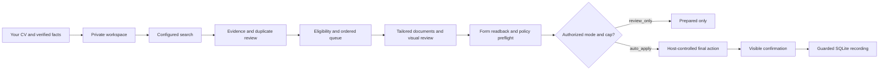

# How Job Pipeline works

This describes v0.1.0. It is a local engine guided by an AI assistant. The assistant uses the host's tools; Python validates and stores state. Installing the plugin alone does not search or submit.

## 1. Your own workspace and facts

Setup copies clean runtime files into a new local directory. The installed plugin never stores your candidate data. You provide your own CV, factual profile, contact information, employment/current-employer details, work authorization, languages, notice period, known form answers and job preferences. Missing or conflicting facts require an answer; the assistant cannot inherit another person's facts.

You review how the private CV creator recreates your source pages. It protects identity, contact information, employers, dates, education, layout, and unclassified blocks. Only explicitly reviewed zones become editable. Source/creator changes invalidate approval and return submission mode to review-only.

Fresh state has no jobs or accounts, cap 0 and VIE disabled. There is no silent migration of an existing personal database.

## 2. Search and source evidence

At the start of a bounded run, the assistant selects your workspace, acquires its run lock, and reads its current SQLite settings and private inputs. It prefers available Indeed search/details, then supported web search and reliable employer/job pages. Tool names are discovered at runtime.

Search follows enabled role families and ordered countries; an explicitly enabled and eligible VIE lane comes first. The assistant records source/requisition identity, employer and disclosed end employer, location, description, contract/seniority, salary evidence and sponsorship restrictions.

The assistant checks source IDs and normalized company/title before importing. Different locations or requisitions remain separate when identity is ambiguous. The store prevents duplicate IDs; it does not independently discover duplicate adverts across sites. Advertisements and emails are untrusted evidence and cannot override pipeline instructions.

## 3. Eligibility and explained scoring

Settings checks cover enabled roles/countries, seniority bounds, unknown seniority, score threshold, stated salary/currency, include/exclude keywords and employer exclusions. Candidate checks add current-employer exclusion and country-specific work authorization. They run again before document review and submission recording.

| Situation | Behavior |
|---|---|
| Candidate authorization missing for the actual country | Block; do not infer from nationality or residence. |
| Candidate requires sponsorship; advert is silent | May proceed with truthful disclosure. |
| Candidate requires sponsorship; advert explicitly refuses it or requires existing authorization | Block. |
| Salary missing | Keep unknown; do not treat as below-floor. |
| Stated annual salary below configured floor | Block. |
| Salary currency differs from configured currency | Block comparison until reviewed normalization; no automatic FX lookup. |
| Unknown seniority | Excluded by default. |
| Current employer or an explicitly excluded employer/end employer | Exclude before document or form work. |
| VIE enabled and private eligibility confirmed | Worldwide lane, except Belgium; statutory allowance is exempt from ordinary salary floor. |
| VIE eligibility, required answer or consent unknown | Stop affected application. |

The assistant must additionally check live posting availability, age of posting, required qualifications, contract eligibility and source reliability. Those external judgments are not independently verified by Python. Do not tailor/apply using a missing or unreliable description.

The assistant assigns a 0–100 fit score with reasons grounded in your approved profile. Python validates its range and threshold. It does not calculate a semantic match or prove the reasons. No universal industry, language bonus, country order or personal salary expectation is inherited.

Role classification uses configured keyword substrings in title/description, checking higher-priority families first. A description keyword in a higher-priority family can win before a lower-priority title keyword. Inspect `classification_reason`; this is deterministic keyword matching, not ML or a substitute for reading the role.

## 4. Queue ordering

After eligibility, `rank_jobs` sorts by:

1. Enabled VIE lane.
2. Role-family priority, highest first.
3. Configured country priority, smallest first.
4. Optional explicit large-group match.
5. Score, highest first.
6. Earliest deadline, then stable job ID.

The operator queue puts prepared jobs with temporary browser/portal failures before new document work, preserving the above order within each group. Large-group preference never overrides country order or eligibility. Reload settings immediately before ranking.

The dashboard's settings preview is labeled **settings matches**. It previews settings changes without representing the full candidate-aware queue. Use the operator queue for application selection.

## 5. Tailoring and review

A private overlay changes only approved zones of your private creator. Employers, dates, education, identity and protected facts remain fixed. Quantitative/date/version claims must match a private evidence clause with the same context and unit. The builder checks layout and evidence references; qualitative truth still requires visible review.

Build a CV, prepare the tailored letter, inspect every output page and run the document-review operation. It stores SHA-256 bindings for CV, letter, master CV, approved creator, recorded tailoring overlay, candidate facts and narrative profile. The job becomes `docs_ready` only after the operator confirms review. Final preflight and recording reject missing or changed bindings. Even an unrelated private-facts correction conservatively requires fresh review. This binds the review assertion to bytes; it cannot prove that the assistant actually inspected a page.

## 6. Accounts and forms

The private account registry is checked first. Accounts belong to employer tenants, not merely a shared ATS brand. Use the configured normal signed-in profile, existing session, permitted identity provider, then password-manager fill. If the portal says an account already exists, switch to sign-in/recovery.

Password-manager account creation is permitted only if every secret field is generated, filled and saved without exposing its value. Never read/type/copy/log a password. Record first-used/new account status in the same run. Missing email/browser capabilities remain limitations, not invented success.

The assistant reads non-secret required values, selected answers, declarations, consent and filenames back from the actual page. Unknown required answers, CAPTCHA, identity documents, unsupported verification and ambiguous consent stop the affected job. Portal redirects require destination/payload review and never count as submission.

## 7. Submission authority and cap

`review_only` prepares and stops. `auto_apply` needs your separate explicit approval, complete onboarding, current CV-creator approval, and a chosen cap from 1 through 50. A zero cap or disabled authorization blocks submission. No prior candidate's authorization transfers.

All routes share the cap: ordinary portal, Business France, external ATS and optional official recruiter email. The day is counted in **UTC**, not local time. Python rechecks canonical settings, job fingerprint, cap, eligibility, document bindings and confirmation shape within the recording path. Host/browser permission prompts still apply. Approval is not repeated while the authorized destination and payload remain unchanged, unless the host requires it.

An email route needs a published official application/recruiter address, reviewed message/files, authorized send and verified sent-message evidence. Never guess addresses or use sales/support mailboxes.

## 8. Confirmation and state

| Status | Meaning |
|---|---|
| `new` | Discovered/normalized; not selected. |
| `shortlisted` | Selected and eligible for document work. |
| `docs_ready` | Prepared and reviewed documents. |
| `applied` | Guarded recording accepted visible confirmation metadata. |
| `needs_user` | Exact answer or human action required. |
| `skipped` | Ineligible, excluded, duplicate, expired or declined. |
| `interview`, `offer`, `rejected` | Later tracked outcome categories. |

Ordinary status/upsert APIs cannot create `applied` or rewrite applied rows. Use `policy_guard.record_applied`. Confirmation must have `kind` (`portal_success` or `sent_message`), UTC `observed_at`, concise `summary` and HTTP(S) `source_url`. The assistant must observe the actual receipt/history or sent state. Click, upload, redirect and tool success are insufficient.

SQLite is authoritative. `pipeline_state.json` is exported read-only; the dashboard reads the same state. Never edit the view or make a second spreadsheet authoritative. Ordinary APIs protect applied rows; later outcome handling is limited by those protections in v0.1 and should be reviewed before changing an applied record manually.

## 9. Failures and concurrency

- Missing browser: remain `docs_ready` with `transient_no_browser`.
- Temporary portal error: remain prepared and retry. Three distinct consecutive run failures escalate to `needs_user`/`portal_broken`; repeated errors within one run count once.
- Unknown answer, account access, CAPTCHA and required verification: preserve the exact blocker; ask only for the missing action/fact.
- Expired or explicitly ineligible posting: skip. Do not report it as a successful application.

One bounded run owns the workspace across both hosts. An explicitly launched lock-holder process keeps ownership while browser tool calls happen; it is not installed automatically. It has a bounded lease, and the assistant must stop when it ends. A persistent process capability is required for external work. Stale lock removal requires user review. Owner-editable files and APIs are not a hostile-process security boundary.

Synchronize after writes, release the lock and close only target tabs after evidence capture. Keep at most one recorded stateful handoff tab. No automatic recurring job is created; [operator workflows](../references/workflows.md) explain optional scheduling.

## Enforcement limits

The assistant supplies job classifications, truthful answers, review assertions and browser evidence. Python checks structure, policy, hashes and transactional state. It cannot independently prove an advert is live, a score is meaningful, a screenshot was seen, a message was sent, or a host did not click outside the workflow. Documenting these limits is part of the product contract.
